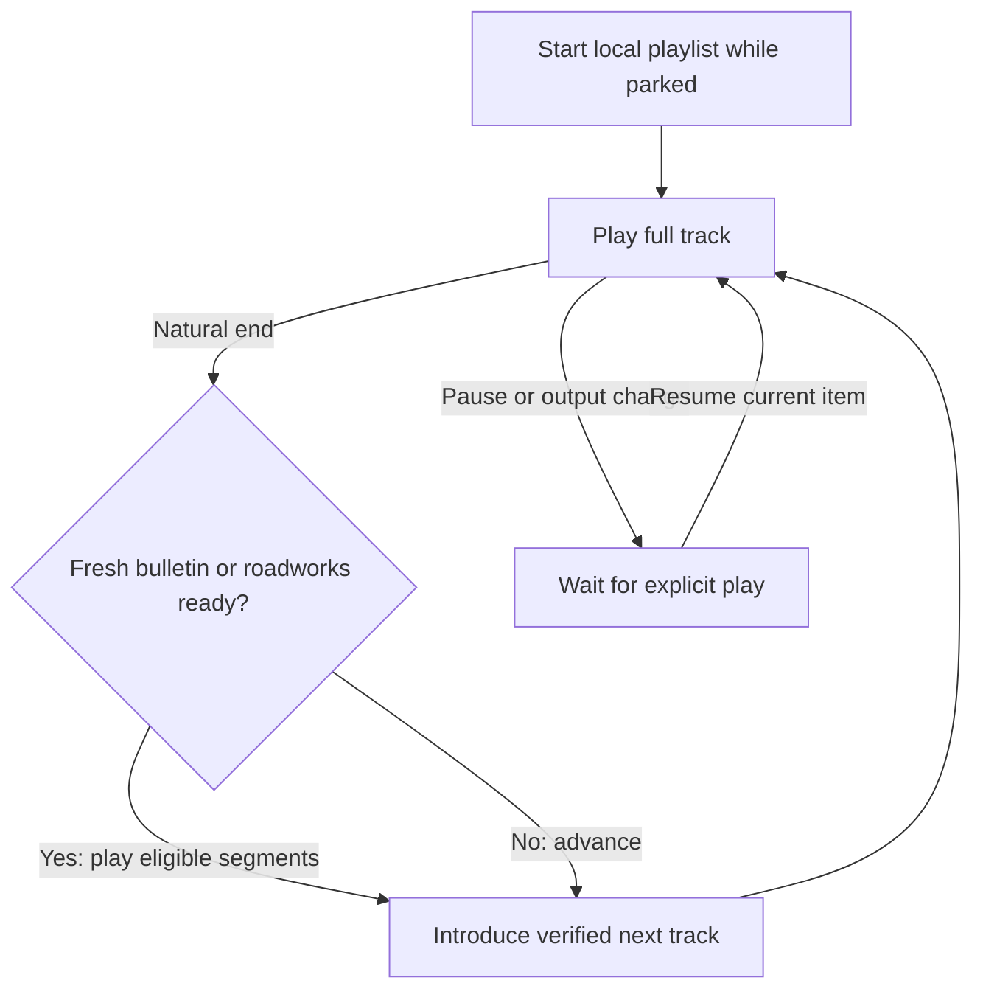
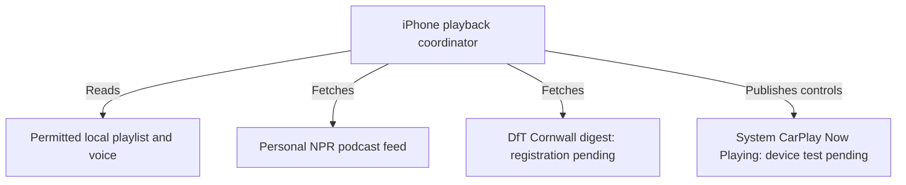
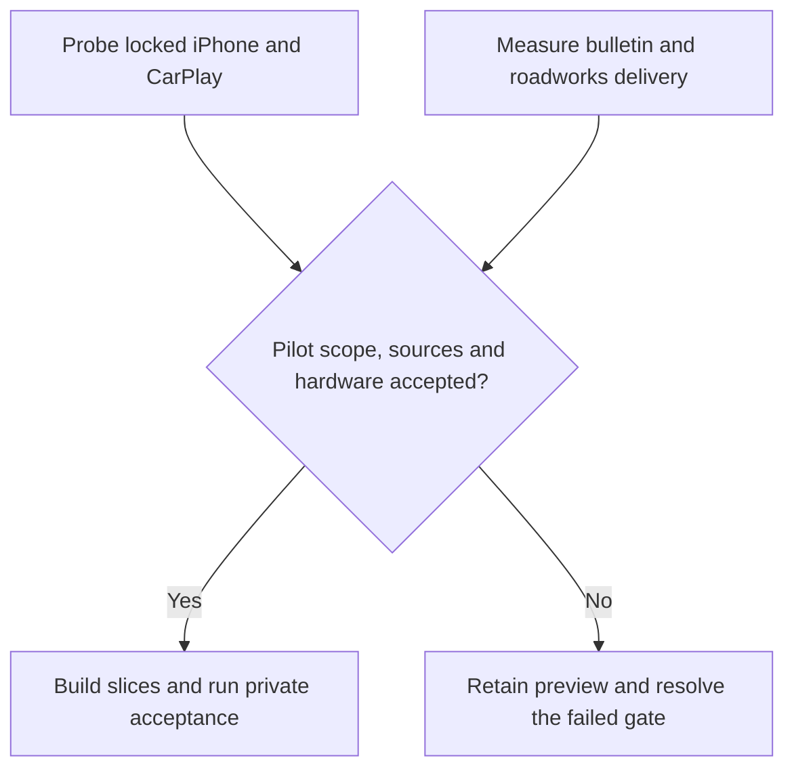

# Personal Radio — private pilot

**Appetite:** Proposed ten working days for feasibility, then up to six build weeks with one iOS engineer and occasional data support. External response times and the spending cap are TBD.\
**Bet type:** Private, single-listener pilot.\
**Outcome:** Start a listening session while parked and hear complete songs, a presenter, an hourly news edition when fresh, and reported Cornwall roadworks through the car, with play, pause and skip working while the phone is locked.\
**Shaped by:** The listener’s V1 plan and source preferences, and the 17 November 2026 feasibility checks.\
**Risk level:** Moderate for a private pilot. The real CarPlay route, live roadworks access and actual bulletin timing still need proof.

## Problem

The listener wants the useful parts of radio and a playlist they choose, with no need to switch apps or handle the phone while driving. Subscription music APIs, licensed UK news files and broad local-incident reporting all introduce external dependencies. A private pilot can establish whether the listening experience is worthwhile using music and content available under personal-use or open-data terms. The listener has accepted reputable alternatives to BBC news and travel. The proposed music, CarPlay interface and roadworks-only scope still need their agreement. See the [V1 feasibility study](Personal-Radio-V1-Feasibility-Study.md).

## Appetite

Use the existing ten-working-day feasibility cap to run the device and live-source checks. Queue a six-week build only after the pilot gates close and the listener accepts the scope and costs. First delivery covers one iPhone and car, a single local playlist, one voice, one news feed and Cornwall roadworks. The listener can start, listen hands-free and recover an interrupted session. Cut optional regional incident expansion before reducing this journey. Apple quotes US$99/year or local equivalent for paid programme membership if required for the chosen signing route. Stage 1 uses existing audio files and public feeds. Receiver hosting and any selected paid signing route need an approved spend cap. [Apple membership fees](https://developer.apple.com/help/account/membership/program-enrollment/), [DfT open-data access](https://findtransportdata.dft.gov.uk/dataset/roadworks-service-api-street-manager)

## Solution — Fat Marker Sketch

1. Import one playlist of permitted DRM-free songs on the iPhone while parked. Enable the news feed and Cornwall roadworks, preview the voice and start. Use the system Now Playing screen in CarPlay during the session.
2. Let each song finish. At a verified boundary play an eligible complete hourly news file, then any fresh relevant roadworks report, then introduce and play the verified next song. The phone can remain locked. Play a given bulletin once and discard stale or superseded reports.
3. Keep music going when a source is unavailable. A deliberate pause, phone call or output change blocks automatic progression until the user chooses to resume. A skip during a bulletin or intro goes to music. Report source availability in the app and keep setup and diagnostics for when parked.

**How the system works**

## Architecture & dependencies

- **App-controlled audio.** SwiftUI for setup and availability, `AVPlayer` with one item active, and a serial session coordinator. Start the next item only after the matching current item finishes. Ignore late callbacks from replaced items. Record held, paused and interrupted states separately. Publish `MPNowPlayingInfoCenter` metadata and handle `MPRemoteCommandCenter` play, pause and skip. Use the `.playback` audio session and audio background mode. Apple documents the system CarPlay Now Playing surface. Verify the actual head unit first. A dedicated app tile and custom CarPlay templates need an audio entitlement. [AVPlayer end event](https://developer.apple.com/documentation/avfoundation/avplayeritem/didplaytoendtimenotification), [Background audio](https://developer.apple.com/documentation/avfoundation/configuring-your-app-for-media-playback), [Apple CarPlay controls](https://support.apple.com/en-euro/guide/iphone/iph5f6b2beb5/ios), [Apple developer walkthrough](https://developer.apple.com/videos/play/wwdc2017/719/), [Audio entitlement](https://developer.apple.com/documentation/bundleresources/entitlements/com.apple.developer.carplay-audio)
- **Hourly news.** Proposed `NPR News Now`, a US and world bulletin, opt-in and fetched directly from the publisher’s RSS to the listener’s iPhone. Match an explicitly dated air hour to a UTC slot and display it in `Europe/London`. Play the unchanged enclosure from the beginning, including embedded sponsorship. Retain attribution and a link. The 17 November sample showed three consecutive editions timestamped 9:31–9:58 after their air hours. The original ten-minute deadline leaves seconds before an eligible boundary. Proposed pilot deadline is `HH:15` local for the corresponding air hour. Test actual completed downloads and eligible boundaries before confirming it. Sky/IRN remains the preferred UK route if automated retrieval and private playback are authorised and samples pass. [Publisher RSS](https://feeds.npr.org/500005/podcast.xml), [NPR terms](https://www.npr.org/about-npr/179876898/terms-of-use), [Sky radio bulletin](https://news.sky.com/story/sky-news-radio-10315836)
- **Cornwall works.** A small HTTPS receiver ingests signed DfT Street Manager notifications and serves an attributed Cornwall digest of active works and closures. Keep source event time, confirmed active window and feed health separate. Prefer an approved initial snapshot. If only notifications are available, label results as reported updates since setup and validate that this remains useful. Use two-minute refresh during listening where supported, five-minute expiry for breaking updates, and confirmed effective windows for planned works. Compose factual spoken reports, deduplicate by stable IDs and version, suppress a stop or cancellation, and limit each insertion to 90 seconds including its intro with five minutes between off-hour insertions. Test village and unclassified roads against Cornwall notices. The pilot’s label is **Cornwall roadworks**. Broad sudden incident coverage is a separate gate. [DfT data and licence](https://findtransportdata.dft.gov.uk/dataset/roadworks-service-api-street-manager), [Notification documentation](https://department-for-transport-streetmanager.github.io/street-manager-docs/open-data/), [Cornwall notices](https://www.cornwall.gov.uk/transport-parking-and-streets/public-transport/planned-public-transport-service-disruptions/)

**Dependencies**

## New dependencies & open-source licensing

| Dependency | Use and obligations | Check before pilot |
| --- | --- | --- |
| Apple SDK, SwiftUI and AVFoundation | Platform tools and native playback. Register or sign one test device using the applicable Apple terms. | Compatible Xcode, iPhone, iOS version and signing route. [Device distribution](https://developer.apple.com/documentation/xcode/distributing-your-app-to-registered-devices) |
| Local tracks | Import files with provenance and private-playback rights. Bandcamp allows eligible personal downloads and listen-in-another-app use. | Confirm listener has suitable files and editable metadata. [Bandcamp terms](https://bandcamp.com/terms_of_use), [Download help](https://bandcamp.com/zendesk/help/downloading) |
| NPR News Now | Personal non-commercial only. Preserve the enclosure, notices and attribution, with a source link. Keep the cache on one device. | Review the exact user-enabled playback and retention configuration under the published terms. [NPR terms](https://www.npr.org/about-npr/179876898/terms-of-use) |
| DfT Street Manager and HTTPS receiver | Open Government Licence for permitted data reuse. Attribute DfT, comply with service terms and verify SNS notifications. | Confirm individual registration, bootstrap method and hosting costs. Record any package licence if a package is adopted. [DfT listing](https://findtransportdata.dft.gov.uk/dataset/roadworks-service-api-street-manager), [DfT delivery](https://department-for-transport-streetmanager.github.io/street-manager-docs/open-data/) |

## User Flow, Usability & Accessibility

On the phone while parked, import the playlist, enable news, choose Cornwall roadworks and start. Show useful empty states for no music, bulletin not ready, and travel unavailable. In the car, spoken names and source labels explain the current item. Provide play, pause and skip on the phone, Lock Screen and system CarPlay Now Playing. Check VoiceOver labels, Dynamic Type, non-colour status indicators and intelligible volume. Confirm the session can continue with another app foregrounded. Avoid phone-based recovery while driving.

## Security

Import with the Files picker and use app-private storage. Verify audio type and size, ignore malformed tags and scope podcast fetches and redirects to approved HTTPS hosts. Enforce bulletin size and duration limits, no XML external entities, and a bounded download timeout. The receiver validates the SNS signature and expected topic before consuming events, rejects replays and oversized input, and exposes only a rate-limited read-only digest. Keep signing material and any supplier secret out of the app and out of logs. Exercise these controls in the relevant slice tests. [DfT sample notifications and signature verification](https://department-for-transport-streetmanager.github.io/street-manager-docs/open-data/)

## Privacy & Personal Data

Use a manual Cornwall setting. No location permission, route history or app account is needed. Store the local playlist, preferences and news opt-in on the device. Evict cached episodes at expiry or once played and allow the listener to remove imports and reset settings. Publisher/CDN requests expose ordinary network data. Keep short redacted event logs for up to seven days and retain only public road facts in the ingest service. Review provider and hosting data flows before the trial.

## AI Usage

Use a local British-English `AVSpeechSynthesizer` voice with fixed scripts for song names, source introductions and roadworks facts. Keep supplied news audio intact. Preview unfamiliar street and artist names, compare speech volume to songs, and count a missed intro when metadata is missing or synthesis fails. Recover by playing music. [Apple on-device speech](https://developer.apple.com/documentation/avfoundation/speech-synthesis)

## Risks & Unknowns

| ID | Risk | Check or decision |
| --- | --- | --- |
| R1 | Imported music, US/world news and works-only travel could leave the pilot less useful. | Listener accepts these trade-offs, an `HH:15` deadline and phone-start/system Now Playing before the build. |
| R2 | The app may lose its audio session, media controls or completion events when locked or switching sources. | Signed real-phone/head-unit probe including natural end, speech, skip, a call and disconnect. Test the actual connection mode. |
| R3 | NPR may arrive too late or lack consistent air-hour metadata. Sky and the BBC have different rights and delivery routes. | Observe consecutive hourly editions on the target device, verify full download and slot mapping, and record missed hours before selecting the feed. |
| R4 | Street Manager registration or delivery may be unavailable, or roadworks coverage may omit useful local cases. | Register an eligible receiver, verify notification and initial-state options, and match local and rural works to Council evidence. |
| R5 | Subscription music and spoken metadata remain unresolved. Sudden incidents across small roads lack verified supplier coverage. | Keep as separate V1 gates, using written Spotify or Apple Music determination plus a device trial, and licensed incident samples and measured Cornwall coverage. |
| R6 | Full Xcode, hardware, time and cash owner are unconfirmed. | Confirm Mac, iPhone, car, signing, capacity and spend cap at kickoff. The desktop checks here used Command Line Tools and macOS only. |

## Circuit Breakers

- **R1 / R6.** If the listener wants subscription music or wider incident coverage from day one, or the device/spend dependency remains unavailable, retain the permitted-audio preview and hold the corresponding build. Do not spend the six-week appetite on provider approval waits.
- **R2.** If system CarPlay Now Playing fails on the real car, identify the failing metadata, control or audio path. Try Apple’s entitled app route only if an approved profile and time are available. A phone-only build is a diagnostic preview.
- **R3.** If complete editions routinely miss the agreed slot, or their use cannot be confirmed under the podcast terms, test a timely licensed Sky/IRN, Radio News Hub or confirmed publisher podcast. Missing news expires and music continues.
- **R4 / R5.** If eligible traffic access or rural works reporting falls short, display unavailable and hold traffic acceptance. Add a separate incident feed only after the supplier’s Cornwall coverage and spoken-use terms pass the original study’s tests.

## Rabbit holes

| Hole | Why it bites | Patch |
| --- | --- | --- |
| Streaming integration first | Rights and locked-track control can consume the entire appetite. | Prove the real session with app-owned files. |
| Waiting silently for an hourly file | Adds dead air and still misses the eligible boundary. | Continue songs until a complete current edition is ready. |
| Treating a road map as event coverage | Road geometry can exist without current incident reporting. | Compare reported events and latency using official examples across road classes. |
| Custom CarPlay browsing or multiple suppliers | Expands signing, testing and integration work. | Start with system controls and one feed per content type. |

## No-gos

No Spotify or Apple Music audio extraction, paid publication, unauthorised relaying or bulletin clipping. No generated news, inferred traffic clearance, continuous GPS or emergency alert guarantees. No phone interaction needed while moving. No launch after force quit or reboot, no Android Auto, and no V2 subscriptions in this bet. A dedicated CarPlay launcher and comprehensive sudden-incident coverage are follow-on options with separate proof and scope decisions.

## Sequencing and done

**Feasibility days 1–3.** Confirm scope and equipment, get a signed build path and put two permitted tracks and a synthetic intervening clip on the phone. Run parked, lock the phone, and verify system CarPlay metadata, play, pause and skip. In parallel check source terms and eligibility and begin timing samples. Use the desktop WAV and scheduler results as component evidence.

**Feasibility days 4–10.** Observe several consecutive hourly editions and capture air hour, first full availability, actual eligible boundary and missed slots. Verify DfT setup, compare live/timed works on trunk and council roads as applicable, including village roads such as St Tudy or Loe Hill, and verify stop/cancellation. Record the tested configuration and capacity at the decision point. Availability waits can extend elapsed time beyond the effort cap.

**Conditional build.** Land the signed listening skeleton, local playlist and presenter, hourly news and Cornwall works as successive vertical slices. Finish with real-car interruption, accessible recovery and a measured trial. Reserve time for device testing and packaging. Pilot acceptance requires all of the following.

- Complete a two-hour locked-screen session on the actual iPhone and car. Record iOS and connection mode. Record at least 50 track boundaries across that run and additional sessions if needed. Zero wrong intros, unintended cuts or overlaps. At least 95% of enabled song intros finish before the corresponding song starts.
- Play a complete fresh edition from the start once per slot at the first eligible natural boundary in at least 95% of controlled healthy-network cases. Test delayed, expired, duplicate and absent editions and both autumn clock-change hours. Record real-world missed hours alongside this rate.
- Announce a confirmed rural roadworks example with the correct source and timing, cover new and changed works and suppress stopped, duplicate and stale reports. Confirm regional wording, outages and the two-minute refresh, five-minute incident expiry, 90-second duration and insertion limits. Check source coverage against the agreed scope.
- Resume music within three seconds after the final spoken or bulletin item in at least 95% of eligible cases. Test manual pause, skip, calls, navigation prompts, signal loss and CarPlay disconnect without forced resumption or phone interaction while driving.
- Deliver a usable signed private installation, source-use record, accessible controls, and named risks with observed coverage and limits.

**Delivery plan**

## Shaping Gate — ready for betting?

**Ready with conditions for the private pilot.** A local playlist, publisher podcast and open works data give it a credible delivery route. The sources are materially different from the provider-based V1. Device proof, the news-window trial, individual DfT eligibility and measured works coverage remain open. The unreconciled differences are decisions for kickoff. Subscription music and fuller local-incident coverage still need the checks in the [V1 feasibility study](Personal-Radio-V1-Feasibility-Study.md).

## Betting Table Decision

**Pending.** The listener is the decision-maker. **Proposed** use the next available hardware access for the signed device test and confirm acceptance of the imported playlist, NPR scope, `HH:15` deadline and Cornwall roadworks coverage in parallel. Start the six-week pilot build only after the remaining gates pass. Retain the original V1 provider and coverage tests for a later upgrade decision.
